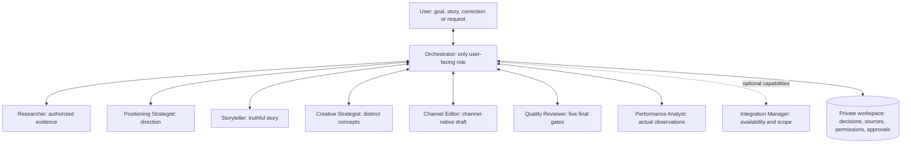
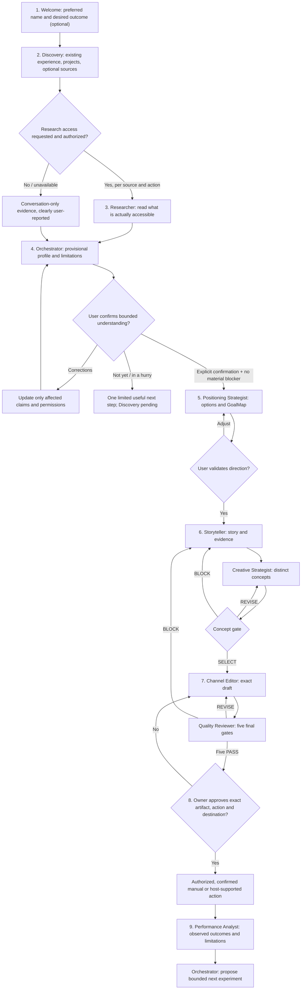

# How it works: from your first conversation to outcomes

**Applies to:** public Personal Branding Agents method **v0.3.0** (prompt-first). This is a practical guide to the [Orchestrator](../agents/orchestrator.md), [conversational onboarding](../workflows/onboarding.md) and [content cycle](../workflows/content-cycle.md), not an additional workflow or an autonomous runtime.

## In one minute

You speak to **one Orchestrator**. It understands your goal, asks only necessary questions, coordinates specialist roles behind the scenes, brings the findings back for your validation, and never publishes or contacts anyone without specific authorization. You can use the method without a CV, social account, public content or paid service.

The lines are **logical task handoffs**, not simultaneously running workers. Specialists return findings **only to the Orchestrator**, never directly to each other or to the user. When the host lacks real multi-agent delegation, one assistant may perform the roles sequentially and must disclose that this is **not independent multi-agent execution**.

## The user's journey

**Important:** not every stage is obligatory for every person. Someone may pursue private mentoring, learning, proof-building or direct work instead of publishing. Publishing is only a branch when it helps the validated outcome and the user approves an exact action.

## What user inputs trigger which work?

| What the user says or shares | Orchestrator response | Specialist, if needed |
| --- | --- | --- |
| “Call me Jo.” | Keep preferred address; ask about outcome only if missing | None |
| “I want more career options.” | Reflect goal; avoid assuming posting or job title | None initially |
| “Here is my CV / portfolio.” | Confirm requested use, freshness and authorized scope | Researcher |
| “Check my LinkedIn.” | Check per-source permission and real tool access; report limitations | Integration Manager if a capability is needed, then Researcher |
| “I don't want to share documents.” | Continue by conversation, label reports correctly | Researcher optional; no unauthorized access |
| “My role in that project was different.” | Update only affected claims and seek focused confirmation | Researcher if new evidence is needed |
| “Yes, this profile represents me.” | Check explicit bounded confirmation and material evidence/consent blockers | Positioning Strategist only once ready |
| “I prefer private mentoring over public visibility.” | Update goal; don't force a publishing plan | Positioning Strategist |
| “Tell the story behind this decision.” | Preserve actual role, choice, observation and lesson | Storyteller |
| “Show different creative angles.” | Compare materially distinct concepts before drafting | Creative Strategist |
| “Draft this for LinkedIn.” | Require selected concept and known channel/language | Channel Editor |
| “Is this ready?” | Check exact artifact and all five gates | Quality Reviewer |
| “Approve and post this version.” | Check owner authority, artifact version/hash, destination and authorized action; host must actually support publishing | Orchestrator; optional capability resolution |
| “What did we learn?” | Use actual receipts, coverage, metrics and costs | Performance Analyst |

### How a handoff works

Orchestrator sends a bounded request with `task_id`, purpose, permitted sources/tools, minimum necessary context, output and privacy restrictions. Specialist returns its task status, findings, evidence references, access report, uncertainties and next step. The Orchestrator verifies that the return matches scope and then explains only what the user needs to decide.

For example: **“Review this portfolio page”** → authorization for that exact page and action → Researcher reports whether it accessed the page, what it extracted and which claims were independently supported → Orchestrator says what was found, what remains unverified and asks one relevant question. A retrieved claim is **not automatically verified**.

## Three different decisions, never interchangeable

| Decision | Means | Does **not** mean |
| --- | --- | --- |
| **Discovery: `validated_for_strategy`** | User confirms a bounded profile and no undisclosed material blocker remains | An unverified achievement becomes fact; positioning or a post is approved |
| **Concept: `SELECT`** | A creative concept is suitable for drafting | Final review or owner approval |
| **Final review: five `PASS` + exact owner approval** | Artifact passed five checks and owner authorized the specific action | The post is already published; a successful scheduling job proves publishing |

The five final gates are **factual accuracy, strategic relevance, editorial clarity, privacy/rights/safety, and authenticity/channel fit**. Review covers the **final artifact**, including media where relevant. A material edit invalidates earlier approval for the changed version. An action is `published` only after confirmed external evidence, not when scheduled.

### What if information conflicts or permission changes?

- A contradiction blocks the **affected claim and decisions relying on it**, not necessarily the whole person. Disclose and exclude it until resolved; continue on unaffected evidence only.
- The user may revoke source-specific access. Stop **new** access under that grant; never imply already processed records were automatically deleted.
- A missing document, inaccessible profile or limited time may lead to one grounded **provisional** observation. Discovery remains pending if its completion conditions are not met.
- Do not repeat answered questions or hide material uncertainty to make a response shorter.

## Practical example (fictional)

1. **User:** “I helped redesign a team workflow and want to explain what I learned.”
2. **Orchestrator:** “What decision did you make personally, and what can we safely support?” The Researcher checks only materials the user authorized.
3. **Storyteller:** produces a StoryBrief with problem, personal role, decision, observed result, unknowns and lesson.
4. **Creative Strategist:** offers distinct angles (trade-off, mistake avoided, practical lesson) and returns a reasoned **SELECT** or revision.
5. **Channel Editor:** drafts for the selected channel, preserving qualifications.
6. **Quality Reviewer:** reports five `PASS`, `REVISE` or `BLOCK` results on the **exact** draft.
7. **User:** approves a particular artifact, version and intended destination. Only then may the separately supported action occur.
8. **Performance Analyst:** interprets real responses and recommends one next experiment, without treating impressions as business results.

## What ships in v0.3.0, and what does not

**Shipped:** portable role prompts, two workflows, contracts, templates, fictional examples and static documentation validation. **Not shipped:** an autonomous orchestrator service, independent worker runtime, live account connectors, scheduler, guaranteed long-term memory, social posting service or automatic analytics. The host may supply tools, but their availability and authority must be established, not assumed.

Actual personal data, source links, transcripts, evidence, approvals and performance records belong in each user's **private workspace**, not this public repository.

**Further reading:** [architecture](architecture.md) · [delegation contracts](agent-contracts.md) · [onboarding](../workflows/onboarding.md) · [content cycle](../workflows/content-cycle.md) · [quality gates](quality-gates.md) · [version 0.3.0](releases/v0.3.0.md).
